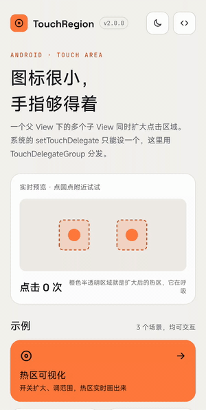
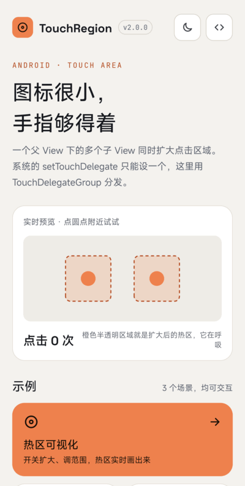
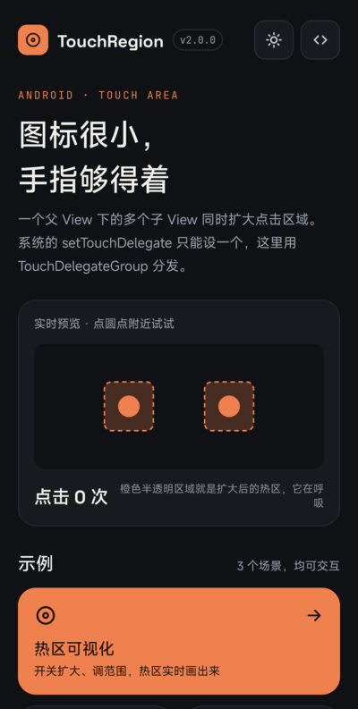
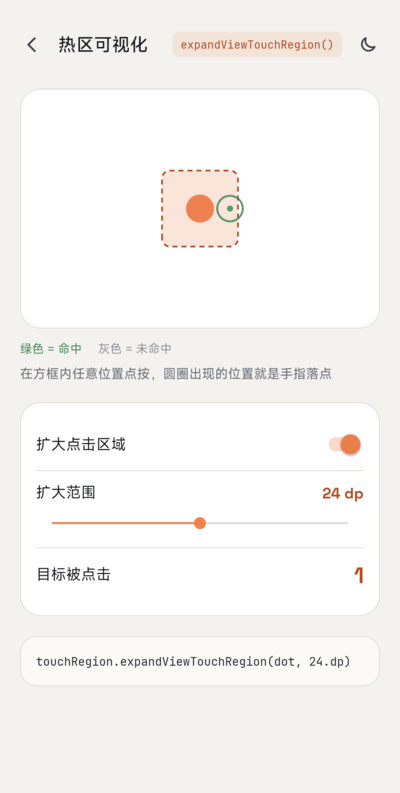
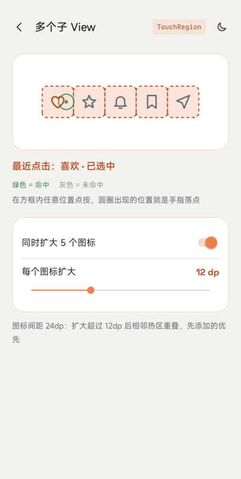
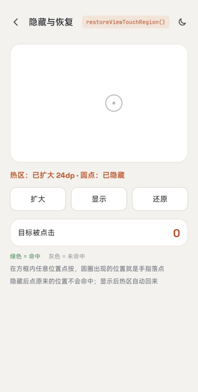

# TouchRegion

[English](README.md) | 简体中文

[](https://jitpack.io/#venshine/TouchRegion)  [](https://github.com/venshine/TouchRegion/actions/workflows/ci.yml)  [](https://developer.android.com/guide/topics/manifest/uses-sdk-element#ApiLevels)

扩大小控件的触摸和点击区域。Kotlin 编写，除 Kotlin 标准库外没有其他依赖。

[**下载示例 APK**](https://github.com/venshine/TouchRegion/releases/download/2.0.0/TouchRegion-sample-2.0.0.apk)

## 截图



| 首页 | 深色模式 | 热区可视化 | 多个子 View | 隐藏与恢复 |
|:---:|:---:|:---:|:---:|:---:|
|  |  |  |  |  |

你需要它吗？
--
只有**一个 View** 时，系统已经够用：在父 View 上设置 [`TouchDelegate`](https://developer.android.com/reference/android/view/TouchDelegate)，或者直接加大 View 的 padding / `minWidth` / `minHeight`。

问题在于一个 ViewGroup 只能有**一个**触摸委托（`View.setTouchDelegate`）。TouchRegion 的价值是用 `TouchDelegateGroup` 把触摸分发给多个委托，让**同一个父 View 下的多个子 View 同时扩大点击区域**。它还在触摸时才计算区域，所以会跟随布局变化，并忽略已隐藏或已移除的子 View（系统 `TouchDelegate` 会一直沿用创建时的矩形）。

无障碍指南推荐触摸目标至少 **48dp x 48dp**。能在布局里解决就优先在布局里解决；视觉尺寸必须保持很小时再用 TouchRegion。

使用
--
##### Gradle：
1. 在 `settings.gradle` 里加入 JitPack 仓库：
```groovy
dependencyResolutionManagement {
    repositories {
        google()
        mavenCentral()
        maven { url = 'https://jitpack.io' }
    }
}
```
2. 在模块的 `build.gradle` 里加入依赖：
```groovy
implementation 'com.github.venshine:TouchRegion:2.0.0'
```

##### Gradle Kotlin DSL：
```kotlin
// settings.gradle.kts
dependencyResolutionManagement {
    repositories {
        google()
        mavenCentral()
        maven("https://jitpack.io")
    }
}

// build.gradle.kts
implementation("com.github.venshine:TouchRegion:2.0.0")
```

> 从 2.0.0 起库改用 Kotlin 编写并通过 JitPack 发布。旧坐标 `com.wx.touchregion:touchregion` 已无法下载。

示例
--
包名仍是 `com.wx.touchregion`。[示例 App](sample) 把扩大后的热区画出来：可调范围的热区可视化、一行图标同时扩大、隐藏与还原，支持浅色 / 深色主题。

##### Kotlin：
```kotlin
val touchRegion = TouchRegion(parentLayout)          // 这些 View 共同的父 View
val margin = (16 * resources.displayMetrics.density).toInt()
touchRegion.expandViewTouchRegion(button1, margin)   // 四周各扩大 16dp
touchRegion.expandViewTouchRegion(button2, 40, 8, 40, 8)  // 左、上、右、下，单位 px
touchRegion.restoreViewTouchRegion(button1)          // 恢复为自身大小
```

##### Java：
```java
TouchRegion touchRegion = new TouchRegion(parentLayout);
touchRegion.expandViewTouchRegion(button1, 300);
touchRegion.expandViewTouchRegion(button2, 500, 100, 500, 100);
```

##### 方法：
| 方法 | 说明 |
|:---|:---|
| `TouchRegion(ViewGroup parent)` | 为 `parent` 的子 View 创建扩大区域工具 |
| `TouchRegion(View child)` | 同上，取 `child` 的父 View（必须已加入父 View，否则抛 `IllegalArgumentException`） |
| `expandViewTouchRegion(View view, int margin)` | 四周各扩大 `margin` px |
| `expandViewTouchRegion(View view, int left, int top, int right, int bottom)` | 四个方向分别扩大（px） |
| `restoreViewTouchRegion(View view)` | 恢复为 View 自身范围 |

说明：
* `view` 必须是传给 `TouchRegion` 的那个父 View 的直接子 View，否则抛 `IllegalArgumentException`。
* 对同一个 View 再次调用 `expandViewTouchRegion` 会替换之前的设置。
* 扩大后的区域不会超出父 View，因为父 View 之外的触摸本来就到不了它。
* 两个子 View 的扩大区域重叠时，先扩大的那个接收触摸。
* `TouchDelegateGroup` 是公开的：`addTouchDelegate`、`removeTouchDelegate`、`clearTouchDelegates`，可以单独用来组合普通的 `TouchDelegate`。

从 1.x 迁移
--
* **坐标**：`com.wx.touchregion:touchregion:1.0.0` 改为 `com.github.venshine:TouchRegion:2.0.0`；`minSdk` 提升到 21。
* `expandViewTouchRegion` 立即生效。1.x 用 `post` 在布局之后才应用，并且区域只计算一次。
* `restoreViewTouchRegion` 现在真的会恢复。1.x 只是在扩大的委托后面再加一个空委托，没有任何效果。
* 对同一个 View 连续扩大两次，后一次替换前一次，不再叠加。
* 区域跟随 View 的布局变化；隐藏（`INVISIBLE` / `GONE`）或已移除的 View 不再接收触摸。
* `expandViewTouchRegion` 不再顺带调用 `view.setEnabled(true)`。
* 传给 `expandViewTouchRegion` 的 View 必须是构造时那个父 View 的直接子 View；以前其他 View 也能传进来，但行为不正确。
* 1.x 的 javadoc 把参数顺序写成 top、bottom、left、right；实际顺序一直是 left、top、right、bottom。

维护状态
--
尽力维护。2.0.0 的 Kotlin 重写已在 Android 17 真机上检查，Robolectric 单元测试会派发真实的触摸事件。

Credits
--
示例 App 打包了以下字体，均为 [SIL Open Font License 1.1](https://openfontlicense.org) 协议（协议原文见 [`sample/licenses/`](sample/licenses)）：
* [Space Grotesk](https://github.com/floriankarsten/space-grotesk)：Copyright 2020 The Space Grotesk Project Authors
* [JetBrains Mono](https://github.com/JetBrains/JetBrainsMono)：Copyright 2020 The JetBrains Mono Project Authors

库本身不包含任何字体。

许可证
--
    Copyright (C) 2016 venshine.cn@gmail.com

    Licensed under the Apache License, Version 2.0 (the "License");
    you may not use this file except in compliance with the License.
    You may obtain a copy of the License at

    http://www.apache.org/licenses/LICENSE-2.0

    Unless required by applicable law or agreed to in writing, software
    distributed under the License is distributed on an "AS IS" BASIS,
    WITHOUT WARRANTIES OR CONDITIONS OF ANY KIND, either express or implied.
    See the License for the specific language governing permissions and
    limitations under the License.
