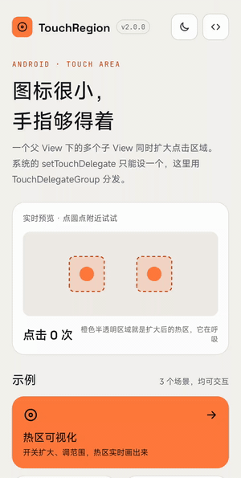
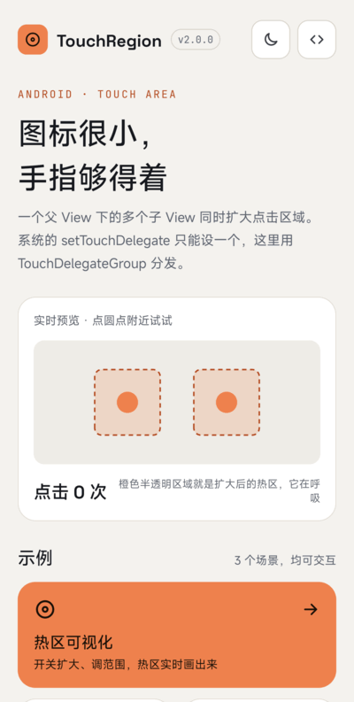
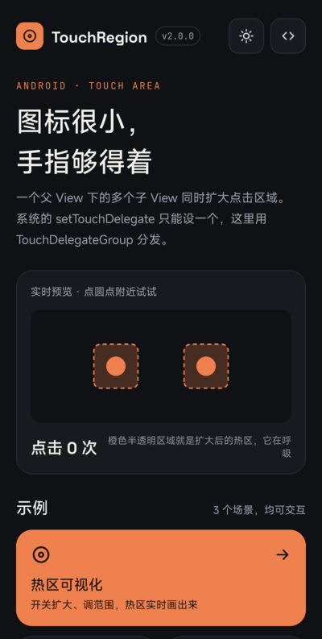
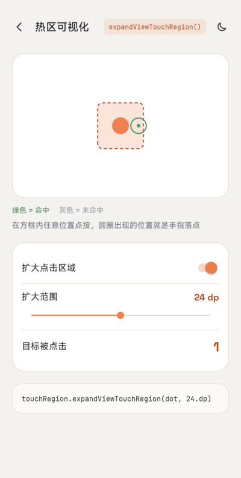
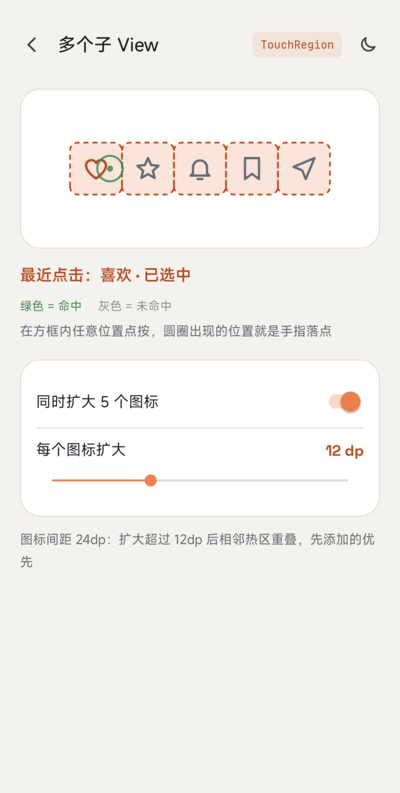
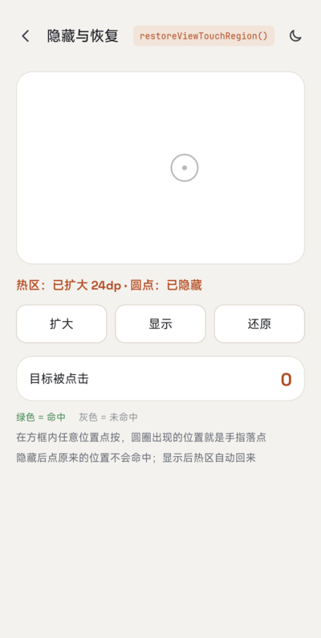

# TouchRegion

English | [简体中文](README-CN.md)

[](https://jitpack.io/#venshine/TouchRegion)  [](https://github.com/venshine/TouchRegion/actions/workflows/ci.yml)  [](https://developer.android.com/guide/topics/manifest/uses-sdk-element#ApiLevels)

Enlarge the touch and click area of small views. Written in Kotlin, no dependencies besides the Kotlin standard library.

[**Download the sample APK**](https://github.com/venshine/TouchRegion/releases/download/2.0.0/TouchRegion-sample-2.0.0.apk)

## Screenshot



| Home | Dark mode | Hot zone | Multiple views | Hide & restore |
|:---:|:---:|:---:|:---:|:---:|
|  |  |  |  |  |

Do you need it?
--
For **a single view**, the platform already has what you need: [`TouchDelegate`](https://developer.android.com/reference/android/view/TouchDelegate) on the parent, or simply larger padding / `minWidth` / `minHeight` on the view.

The catch is that a view group has only **one** touch delegate (`View.setTouchDelegate`). TouchRegion's value is a `TouchDelegateGroup` that dispatches to many delegates, so **several children of the same parent can all get a larger click area**. It also computes the area at touch time, so it follows layout changes and ignores children that are hidden or removed (a plain `TouchDelegate` keeps the rectangle from when it was created).

Accessibility guidance recommends touch targets of at least **48dp x 48dp**. Prefer fixing that in the layout when you can; use TouchRegion when the visual size must stay small.

Usage
--
##### Gradle:
1. Add the JitPack repository to `settings.gradle`:
```groovy
dependencyResolutionManagement {
    repositories {
        google()
        mavenCentral()
        maven { url = 'https://jitpack.io' }
    }
}
```
2. Add the dependency to your module's `build.gradle`:
```groovy
implementation 'com.github.venshine:TouchRegion:2.0.0'
```

##### Gradle Kotlin DSL:
```kotlin
// settings.gradle.kts
dependencyResolutionManagement {
    repositories {
        google()
        mavenCentral()
        maven("https://jitpack.io")
    }
}

// build.gradle.kts
implementation("com.github.venshine:TouchRegion:2.0.0")
```

> Since 2.0.0 the library is written in Kotlin and published via JitPack. The old coordinate `com.wx.touchregion:touchregion` can no longer be downloaded.

Demo
--
The package name is still `com.wx.touchregion`. The [sample app](sample) visualizes the enlarged hot zones: a zone viewer with an adjustable range, a row of icons enlarged together, and hiding / restoring a view; it supports light and dark themes.

##### Kotlin:
```kotlin
val touchRegion = TouchRegion(parentLayout)          // the common parent of the views
val margin = (16 * resources.displayMetrics.density).toInt()
touchRegion.expandViewTouchRegion(button1, margin)   // 16dp on every side
touchRegion.expandViewTouchRegion(button2, 40, 8, 40, 8)  // left, top, right, bottom in px
touchRegion.restoreViewTouchRegion(button1)          // back to its own size
```

##### Java:
```java
TouchRegion touchRegion = new TouchRegion(parentLayout);
touchRegion.expandViewTouchRegion(button1, 300);
touchRegion.expandViewTouchRegion(button2, 500, 100, 500, 100);
```

##### Methods:
| method | description |
|:---|:---|
| `TouchRegion(ViewGroup parent)` | Create a region helper for the children of `parent` |
| `TouchRegion(View child)` | Same, using the parent of `child` (it must already be attached; otherwise `IllegalArgumentException`) |
| `expandViewTouchRegion(View view, int margin)` | Enlarge by `margin` px on every side |
| `expandViewTouchRegion(View view, int left, int top, int right, int bottom)` | Enlarge by a different amount per side (px) |
| `restoreViewTouchRegion(View view)` | Back to the view's own bounds |

Notes:
* `view` must be a direct child of the parent given to `TouchRegion`; otherwise `IllegalArgumentException`.
* Calling `expandViewTouchRegion` again for the same view replaces the earlier margins.
* The area never extends beyond the parent, because touches outside the parent never reach it.
* Where the areas of two children overlap, the one that was enlarged first gets the touch.
* `TouchDelegateGroup` is public: `addTouchDelegate`, `removeTouchDelegate`, `clearTouchDelegates`. You can use it alone to combine ordinary `TouchDelegate`s.

Migrating from 1.x
--
* **Coordinate**: `com.wx.touchregion:touchregion:1.0.0` becomes `com.github.venshine:TouchRegion:2.0.0`; `minSdk` is now 21.
* `expandViewTouchRegion` takes effect immediately. 1.x applied it with `post` after layout and computed the area once.
* `restoreViewTouchRegion` now really restores. In 1.x it added an empty delegate behind the enlarged one, which did nothing.
* Expanding the same view twice replaces the first margins instead of stacking up.
* The area follows the view when its layout changes, and hidden (`INVISIBLE` / `GONE`) or removed views no longer receive touches.
* `expandViewTouchRegion` no longer calls `view.setEnabled(true)` as a side effect.
* The view passed to `expandViewTouchRegion` must be a direct child of the parent given to the constructor. Other views used to be accepted and misbehaved.
* The javadoc of 1.x listed the margin order as top, bottom, left, right; the real order was and is left, top, right, bottom.

Status
--
Maintained on a best-effort basis. Not yet verified on a real device with the 2.0.0 rewrite; the behavior is covered by Robolectric unit tests that dispatch real touch events.

Credits
--
The sample app bundles these fonts, both licensed under the [SIL Open Font License 1.1](https://openfontlicense.org) (license texts in [`sample/licenses/`](sample/licenses)):
* [Space Grotesk](https://github.com/floriankarsten/space-grotesk): Copyright 2020 The Space Grotesk Project Authors
* [JetBrains Mono](https://github.com/JetBrains/JetBrainsMono): Copyright 2020 The JetBrains Mono Project Authors

The library itself bundles no fonts.

License
--
    Copyright (C) 2016 venshine.cn@gmail.com

    Licensed under the Apache License, Version 2.0 (the "License");
    you may not use this file except in compliance with the License.
    You may obtain a copy of the License at

    http://www.apache.org/licenses/LICENSE-2.0

    Unless required by applicable law or agreed to in writing, software
    distributed under the License is distributed on an "AS IS" BASIS,
    WITHOUT WARRANTIES OR CONDITIONS OF ANY KIND, either express or implied.
    See the License for the specific language governing permissions and
    limitations under the License.
